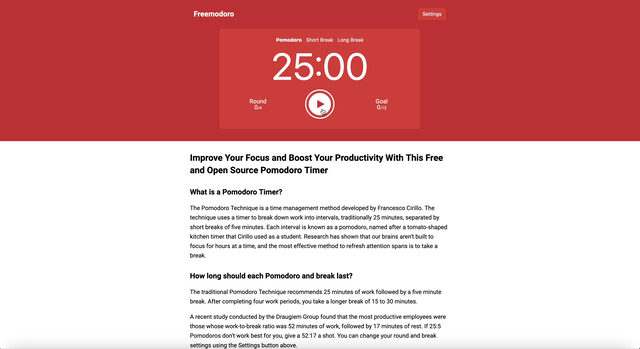

# Freemodoro
Improve Your Focus and Boost Your Productivity With This [Free and Open Source Pomodoro Timer](https://jaredblumer.github.io/freemodoro/).



## What is a Pomodoro Timer?
The Pomodoro Technique is a time management method developed by Francesco Cirillo. The technique uses a timer to break down work into intervals, traditionally 25 minutes, separated by short breaks of five minutes. Each interval is known as a pomodoro, named after a tomato-shaped kitchen timer that Cirillo used as a student. Research has shown that our brains aren't built to focus for hours at a time, and the most effective method to refresh attention spans is to take a break.

## How long should each Pomodoro and break last?
The traditional Pomodoro Technique recommends 25 minutes of work followed by a five minute break. After completing four work periods, you take a longer break of 15 to 30 minutes.

A recent study conducted by the Draugiem Group found that the most productive employees were those whose work-to-break ratio was 52 minutes of work, followed by 17 minutes of rest. If 25:5 Pomodoros don't work best for you, give a 52:17 a shot. You can change your round and break settings using the Settings button above.

## Technologies Used
- **React** for the user interface
- **Redux** for state management
- **React Router** for routing
- **Jest** and **React Testing Library** for testing
- **ESLint** for linting

## Running Locally

Freemodoro is a [Create React App](https://create-react-app.dev/) project that runs entirely in the browser — no backend or database required.

### Prerequisites

- **Node.js** (a current LTS release) and **npm**

### Setup

```bash
git clone https://github.com/jaredblumer/freemodoro.git
cd freemodoro
npm install
```

> On a modern Node version, the older dependencies may require `npm install --legacy-peer-deps`.

### Run the app

```bash
npm start
```

This starts the development server at **http://localhost:3000**.

### Other commands

```bash
npm test       # run the Jest test suite
npm run build  # create a production build in build/
```

## License
Distributed under GNU General Public License v3.0. See `LICENSE` for more information.

## Author
**Jared Blumer**, Full-Stack Software Engineer and Data Analyst
- [GitHub](https://github.com/jaredblumer)
- [LinkedIn](https://www.linkedin.com/in/jaredblumer/)
